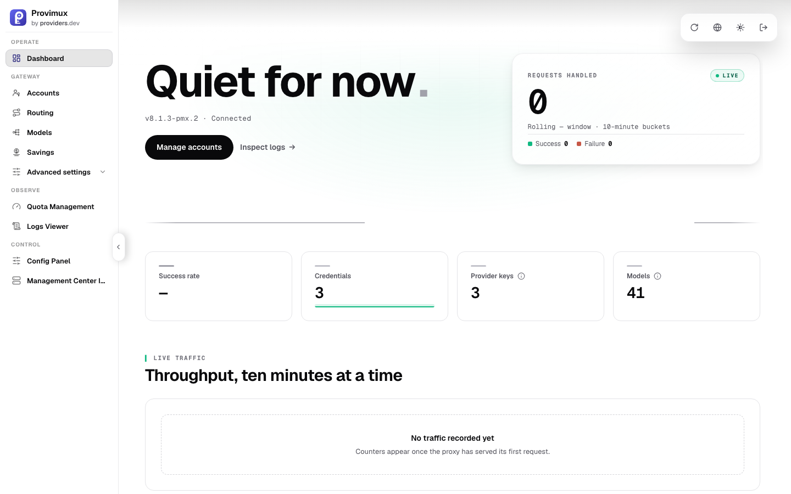

<h1>
  <a href="https://providers.dev"><picture>
    <source media="(prefers-color-scheme: dark)" srcset="assets/lockup-dark.svg">
    
  </picture></a>
</h1>

provimux-ui, by [providers.dev](https://providers.dev), is the web console of
[Provimux](https://github.com/ngvoicu/provimux): one page in your browser to sign in to your AI subscriptions, manage
API keys and auth files, watch quotas and logs, and edit the config of your local Provimux. It is the
[CLI Proxy API Management Center](https://github.com/router-for-me/Cli-Proxy-API-Management-Center) with the look of
providers.dev, so it also works with CLIProxyAPI itself.

<picture>
  <source media="(prefers-color-scheme: dark)" srcset="assets/dashboard-desktop-dark.png">
  
</picture>

Then: [What differs from the original console](#what-differs-from-the-original-console) · [Use it](#use-it) ·
[Build it](#build-it) · [Built on](#built-on) · [License](#license)

## What differs from the original console

**The providers.dev look.** The console reads "Provimux by providers.dev" in the tab title, favicon, sidebar, login
page and footer, with providers.dev's colours and type (Geist and Geist Mono), in three themes: white, soft grey and
dark. The pages, the settings and the requests the console sends are the original's.

<table>
  <tr>
    <td width="50%"><picture>
      <source media="(prefers-color-scheme: dark)" srcset="assets/login-desktop-dark.png">
      
    </picture></td>
    <td width="50%"><picture>
      <source media="(prefers-color-scheme: dark)" srcset="assets/system-desktop-dark.png">
      
    </picture></td>
  </tr>
</table>

**The Provimux version on the System page.** Connected to Provimux, the Management Center Info page shows its
version and the CLIProxyAPI release it is based on ("Provimux version 8.0.78-pmx.1 (based on CLIProxyAPI 8.0.78)").
Connected to CLIProxyAPI, it shows CLIProxyAPI's version, as the original does. The quick links point to Provimux,
providers.dev, CLIProxyAPI and the original console.

**No sponsors or affiliate links.** The original's sponsor page ("Quick Start"), the sponsor row under the proxy
URL setting and the affiliate sign-up links on provider presets are hidden. A test fails when a new upstream release
adds an affiliate link that is not hidden.

The pages for what Provimux adds to CLIProxyAPI are planned.

## Use it

Provimux will download the console by itself once it is wired to this repository; until then it serves the original
console. To use provimux-ui now, give Provimux (or CLIProxyAPI) its `management.html`: the asset of the
[latest release](https://github.com/ngvoicu/provimux-ui/releases/latest) of this repository, or
[your own build](#build-it).

1. Download `management.html` and its checksum into a folder, for example `~/provimux-ui`, and check it:

   ```bash
   mkdir -p ~/provimux-ui && cd ~/provimux-ui
   curl -fLO https://github.com/ngvoicu/provimux-ui/releases/latest/download/management.html
   curl -fLO https://github.com/ngvoicu/provimux-ui/releases/latest/download/checksums.txt
   shasum -a 256 -c checksums.txt   # on Linux: sha256sum -c checksums.txt
   ```

   It prints `management.html: OK`. The file carries the console's MIT license notice in a comment at its top.

2. In your config, stop the console's automatic updates. Otherwise Provimux replaces the file at startup and every
   3 hours with the latest release of `panel-github-repository`, which is the original console:

   ```yaml
   management:
     disable-auto-update-panel: true
   ```

   Put it in your config's existing `management:` block if it has one. Configs from before CLIProxyAPI v8 call that
   block `remote-management:`; Provimux reads it too, but when a config has both, set the key in `management:`.

3. Start Provimux with `MANAGEMENT_STATIC_PATH` set to that folder (or to the file itself):

   ```bash
   MANAGEMENT_STATIC_PATH="$HOME/provimux-ui" provimux --config /path/to/your/config.yaml
   ```

4. Open `http://127.0.0.1:8317/management.html` and sign in with your management key (`management.secret-key`).

Without `MANAGEMENT_STATIC_PATH`, the console lives in a `static` folder next to your config file (or under
`WRITABLE_PATH` when that is set): replacing `static/management.html` there, with automatic updates off, works too.
The console is served only when `management.disable-control-panel` is `false`, the default.

## Build it

With [Bun](https://bun.sh):

```bash
git clone https://github.com/ngvoicu/provimux-ui
cd provimux-ui
bun install && bun run build
```

The build is a single file, `dist/index.html`, with its scripts, styles and fonts inlined; rename it to
`management.html` to serve it as above. `bun run dev` starts a local server for working on it, and `bun run verify`
runs the tests, the linter and the build.

Releases are built and published by a GitHub workflow from a `v<base>-pmx.<n>` tag; each starts as a prerelease
and becomes the latest release once the published file has passed its checks, including a headless browser run
against a stub of the management API. Each new release of the original console is rebased onto, checked and
released automatically. See [.github/provimux/releases.md](provimux/releases.md) and
[.github/provimux/SYNC.md](provimux/SYNC.md).

## Built on

provimux-ui is the [CLI Proxy API Management Center](https://github.com/router-for-me/Cli-Proxy-API-Management-Center)
by [Router-For.ME](https://github.com/router-for-me) and
[its contributors](https://github.com/router-for-me/Cli-Proxy-API-Management-Center/graphs/contributors), MIT
licensed: every page, setting and request in the console is their work. It manages
[CLIProxyAPI](https://github.com/router-for-me/CLIProxyAPI), which Provimux is a distribution of.

It stays close to the original on purpose. Each provimux-ui version is an upstream console release with a thin
Provimux layer on top:

- everything Provimux is in new files under `src/provimux/` (brand, theme, translations of the brand, the System
  page's lines and links, the sponsor hiding);
- the original's files reach it only through one-line seams: an import, a logo, a line on a page;
- the parts of the console that compose requests to AI providers (quota and usage calls, OAuth logins, model lists,
  the AI Providers page's connection test and key usage check) are never changed: a check on every push and pull
  request, `provimux-ui-guard`, fails when a Provimux commit touches them.

The original's README, in [English](../README.md) and [Chinese](../README_CN.md), describes the console's features.

## License

MIT, like the original console. See [LICENSE](../LICENSE). Geist and Geist Mono are under the SIL Open Font License
([OFL.txt](../src/provimux/theme/fonts/OFL.txt)).
