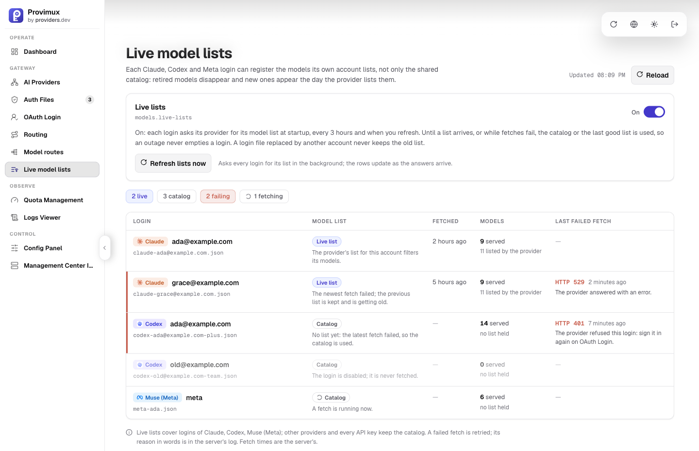
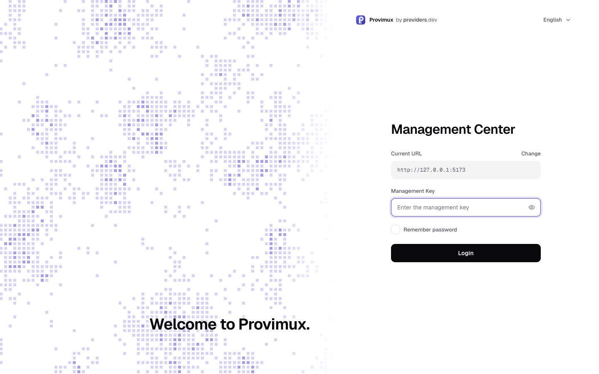

<h1>
  <a href="https://providers.dev"><picture>
    <source media="(prefers-color-scheme: dark)" srcset="assets/lockup-dark.svg">
    
  </picture></a>
</h1>

<p>
  <a href="https://github.com/ngvoicu/provimux-ui/releases/latest"></a>
  <a href="../LICENSE"></a>
  <a href="https://github.com/router-for-me/Cli-Proxy-API-Management-Center"></a>
</p>

**One key for every AI account.**

The web console for Provimux and CLIProxyAPI. With Provimux, it shows which account serves each model, why a route is
paused, and each login's own model list.

**provimux-ui**, by [providers.dev](https://providers.dev), is the web console of
[Provimux](https://github.com/ngvoicu/provimux), the self-hosted AI gateway for you or your whole team that keeps your
prompt cache in use and shows which account answered each request. One page in your browser to manage your API keys (API key, `apikey`) and
accounts, see on **Model routes** which accounts serve each model, by priority, with the cooldown recorded and its
reason, check each login's **Live model list**, watch quotas and logs, and edit the config. It is built on the
[CLI Proxy API Management Center](https://github.com/router-for-me/Cli-Proxy-API-Management-Center) by router-for-me:
every page of the original, in the providers.dev look, plus Provimux's own pages. Provimux downloads it by itself.

**[Provimux](https://github.com/ngvoicu/provimux)** · the endpoint &nbsp;·&nbsp; **provimux-ui** · its web console (this
repository) &nbsp;·&nbsp; **[providers.dev](https://providers.dev)**

<picture>
  <source media="(prefers-color-scheme: dark)" srcset="assets/dashboard-desktop-dark.png">
  
</picture>

## What provimux-ui adds

- **[Provimux's own pages](#provimuxs-own-pages)**: **Model routes**, which API keys and logins serve each model, by
  priority, with the cooldowns Provimux recorded and their reasons, and which OpenRouter entries get Provimux's cache
  markers; and **Model lists**, which list decides each login's models and how old it is, with a refresh.
- **[The providers.dev look](#the-providersdev-look)**: "Provimux by providers.dev" throughout, in three themes.
- **[The Provimux version](#the-provimux-version-and-the-console-on-the-system-page)** and the console's update source
  on the System page.
- **[No sponsors or affiliate links](#no-sponsors-or-affiliate-links).**

Then: [Use it](#use-it) · [Versions and releases](#versions-and-releases) · [Build it](#build-it) ·
[Support](#support) · [Built on](#built-on-the-cli-proxy-api-management-center) · [License](#license)

### Provimux's own pages

From v1.28.3-pmx.2, in the sidebar under Gateway:

<table>
  <tr>
    <td width="50%"><picture>
      <source media="(prefers-color-scheme: dark)" srcset="assets/model-routes-desktop-dark.png">
      
    </picture></td>
    <td width="50%"><picture>
      <source media="(prefers-color-scheme: dark)" srcset="assets/live-lists-desktop-dark.png">
      
    </picture></td>
  </tr>
</table>

**Model routes.** For each model, every subscription login and API key that serves it, by priority (a higher priority
is tried first; routes that share one are chosen between by the routing strategy): subscription in green, API key in
amber, the provider, the login as Auth Files names it or the key's host, its context and output limits, its reasoning
levels, and the cooldown Provimux recorded on it, counting down. A recorded cooldown is a record, not a verdict on
availability. On the same page: **Devin's quota pause per model** (`oauth.providers.devin.model-level-cooling`), with
the Devin cooldowns it is causing now, and **OpenRouter**: the OpenAI-compatible entries on openrouter.ai that Provimux
gives cache markers, a session header and OpenRouter's own limits, with a link to edit them on AI Providers, where
such an entry carries an "OpenRouter · Provimux" tag.

**Model lists.** The `models.live-lists` switch, a refresh request (the page says what the server answered; the
rows then show each login's state as of the latest status read), a line saying which published (providers.dev) list
the server holds, and for each login: the list that decides its models (its provider's live list, the published list,
the built-in list or none), how old that list is, with a mark once it is a day old and when it no longer counts after
7 days, whether it was read from the server's disk cache, how many models the provider listed, how many the login
serves and how many of them the catalog does not have yet, and the last failed fetch (when, its category and HTTP
status). **Models** opens a login's models, with where each one and each of its values came from. On a Provimux older
than the `model-lists` endpoint the same item is the earlier **Live model lists** page, for Claude, Codex and Meta
logins.

These pages use endpoints only Provimux has (`/v8/management/provimux/…`, described in
[Provimux's README](https://github.com/ngvoicu/provimux/blob/main/.github/README.md#model-routes-and-live-list-status-for-the-console)).
Connected to CLIProxyAPI, which answers 404 there, they are not in the sidebar and their addresses open the dashboard;
any other error shows on the page, with a retry.

### The providers.dev look

The console reads "Provimux by providers.dev" in the tab title, favicon, sidebar, login page and footer, with
providers.dev's colours and type (Geist and Geist Mono), in three themes: white, soft grey and dark. The original's
pages, settings and requests are unchanged; Provimux's own pages come on top of them.

<table>
  <tr>
    <td width="50%"><picture>
      <source media="(prefers-color-scheme: dark)" srcset="assets/login-desktop-dark.png">
      
    </picture></td>
    <td width="50%"><picture>
      <source media="(prefers-color-scheme: dark)" srcset="assets/system-desktop-dark.png">
      
    </picture></td>
  </tr>
</table>

### The Provimux version and the console on the System page

Connected to Provimux, the Management Center Info page shows its version and the CLIProxyAPI release it is based on
("Provimux version 8.0.79-pmx.1 (based on CLIProxyAPI 8.0.79)"). Connected to CLIProxyAPI, it shows CLIProxyAPI's
version, as the original does. The quick links point to Provimux, providers.dev, CLIProxyAPI and the original console.
From v1.28.3-pmx.2 it also shows which console release is installed, and its update source: where the server's updater
fetches new releases (`management.panel-github-repository`, resolved with the updater's own rules, so a value the
updater cannot use shows the default it falls back to) and whether it updates itself.

### No sponsors or affiliate links

The original's sponsor page ("Quick Start"), the sponsor row under the proxy URL setting and the affiliate sign-up
links on provider presets are hidden. A test fails when a new upstream release adds an affiliate link that is not
hidden.

## Use it

**With Provimux, there is nothing to do.** Provimux downloads the latest provimux-ui release by itself, at startup and
every 3 hours, and installs it only when it matches the release's `checksums.txt`; a config that still names the
original console (`management.panel-github-repository`) gets provimux-ui too. Open
`http://127.0.0.1:8317/management.html` (on the same machine; from another machine, use the server's address) and sign
in with your management key (`management.secret-key`). To install Provimux, see
[its README](https://github.com/ngvoicu/provimux/blob/main/.github/README.md#install).

**For a team.** Provimux on a server your team shares serves everyone you choose, each with their own client key; to
open the console to other machines, set `management.allow-remote: true`. See
[For a team](https://github.com/ngvoicu/provimux/blob/main/.github/README.md#for-a-team) in Provimux's README.

**A release of your choice, or with CLIProxyAPI.** Give the server provimux-ui's `management.html` yourself: the asset
of a [release](https://github.com/ngvoicu/provimux-ui/releases) of this repository, or [your own build](#build-it).

1. Download `management.html` and its checksum into a folder, for example `~/provimux-ui`, and check it:

   ```bash
   mkdir -p ~/provimux-ui && cd ~/provimux-ui
   curl -fLO https://github.com/ngvoicu/provimux-ui/releases/latest/download/management.html
   curl -fLO https://github.com/ngvoicu/provimux-ui/releases/latest/download/checksums.txt
   shasum -a 256 -c checksums.txt   # on Linux: sha256sum -c checksums.txt
   ```

   It prints `management.html: OK`. For another release, replace `latest/download` with `download/<tag>`. The file
   carries the console's MIT license notice in a comment at its top.

2. In your config, stop the console's automatic updates. Otherwise the server replaces the file at startup and every
   3 hours with its own choice: Provimux with the latest provimux-ui, CLIProxyAPI with the original console:

   ```yaml
   management:
     disable-auto-update-panel: true
   ```

   Put it in your config's existing `management:` block if it has one. Configs from before CLIProxyAPI v8 call that
   block `remote-management:`; the server reads it too, but when a config has both, set the key in `management:`.

3. Start the server with `MANAGEMENT_STATIC_PATH` set to that folder (or to the file itself):

   ```bash
   MANAGEMENT_STATIC_PATH="$HOME/provimux-ui" provimux --config /path/to/your/config.yaml
   ```

4. Open `http://127.0.0.1:8317/management.html` (on the same machine; from another machine, use the server's
   address) and sign in with your management key (`management.secret-key`).

**Accounts.** Add API keys on the AI Providers page. For a company, use API keys and cloud accounts (for example
Vertex), billed to the company under its own agreement with the provider.

The OAuth Login page adds subscription logins (`oauth`). Provimux also accepts subscription logins for your own
account, for your own use. Whether a provider allows a third-party tool to use its subscription login is that
provider's decision: Anthropic's terms do not allow it, and OpenAI has not authorized it. Read your provider's terms
before you add a login; the account is yours and so is the risk. Provimux is not affiliated with or endorsed by
Anthropic or OpenAI.

Without `MANAGEMENT_STATIC_PATH`, the console lives in a `static` folder next to your config file (or under
`WRITABLE_PATH` when that is set): replacing `static/management.html` there, with automatic updates off, works too.
The console is served only when `management.disable-control-panel` is `false`, the default.

## Versions and releases

A provimux-ui version names the console release it is built on: `v1.28.3-pmx.1` is the CLI Proxy API Management Center
1.28.3 with Provimux build 1.

Releases are automatic. When the original console publishes a release, a workflow moves provimux-ui onto it, runs the
tests, the linter and the build, and when the check passes publishes `v<base>-pmx.1` on its own. Each release starts
as a prerelease and becomes the latest release once the published `management.html` has passed its checks, including
a headless browser run against a stub of the management API; Provimux then picks it up within 3 hours. A release that
fails a check waits for the owner, and the reason is in an issue. See
[.github/provimux/releases.md](provimux/releases.md) and [.github/provimux/SYNC.md](provimux/SYNC.md).

## Build it

With [Bun](https://bun.sh):

```bash
git clone https://github.com/ngvoicu/provimux-ui
cd provimux-ui
bun install && bun run build
```

The build is a single file, `dist/index.html`, with its scripts, styles and fonts inlined; rename it to
`management.html` to serve it as above. `bun run dev` starts a local server for working on it, and `bun run verify`
runs the tests, the linter and the build.

## Support

Provimux is free and stays open source (MIT). For companies that run it, providers.dev offers support plans:
**Community** (free: GitHub issues and discussions, best effort) and **Team**, **Business** and **Priority** (paid),
listed with prices and terms at [providers.dev/support](https://providers.dev/support/). A paid plan buys a private
channel and a first reply within a stated number of business days: a reply, not a promised fix. Provimux has one
maintainer, and we say so: announced holidays pause the clock, there is no 24/7 and no uptime promise for a service
you host yourself, and the code stays MIT, so you can always fork it.

## Built on the CLI Proxy API Management Center

provimux-ui is the [CLI Proxy API Management Center](https://github.com/router-for-me/Cli-Proxy-API-Management-Center)
by [Router-For.ME](https://github.com/router-for-me) and
[its contributors](https://github.com/router-for-me/Cli-Proxy-API-Management-Center/graphs/contributors), MIT
licensed: every page, setting and request in the console is their work, except Provimux's own pages. It manages
[CLIProxyAPI](https://github.com/router-for-me/CLIProxyAPI), which Provimux is a distribution of.

It stays close to the original on purpose. Each provimux-ui version is an upstream console release with a thin
Provimux layer on top:

- everything Provimux is in new files under `src/provimux/` (brand, theme, translations of the brand, the System
  page's lines and links, the sponsor hiding, Provimux's pages and their API clients);
- the original's files reach it only through one-line seams: an import, a logo, a line on a page;
- the parts of the console that compose requests to AI providers (quota and usage calls, OAuth logins, model lists,
  the AI Providers page's connection test and key usage check) are never changed: a check on every push and pull
  request, `provimux-ui-guard`, fails when a Provimux commit touches them.

The original's README, in [English](https://github.com/router-for-me/Cli-Proxy-API-Management-Center/blob/main/README.md) and [Chinese](https://github.com/router-for-me/Cli-Proxy-API-Management-Center/blob/main/README_CN.md), describes the
console's features.

This repository's GitHub **Sponsor** button goes to [the owner's GitHub Sponsors](https://github.com/sponsors/ngvoicu).
Sponsorships support Provimux and the owner's other open-source tools.

## License

MIT, like the original console. See [LICENSE](../LICENSE). Geist and Geist Mono are under the SIL Open Font License
([OFL.txt](../src/provimux/theme/fonts/OFL.txt)).
